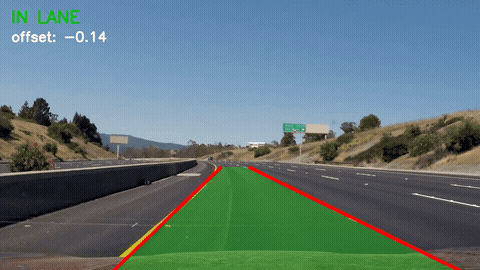
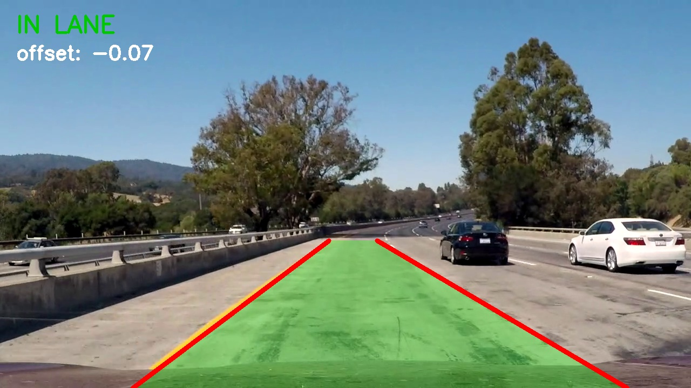

# Lane Detection + Lane Departure Warning (Classical CV)



## Problem Statement

A driver-assistance system needs to know where the lane is and whether the car is drifting out of it. This project aims tosee how far I could get with just one front-facing dashcam and classical computer vision. No deep learning, no training data.

## Objective

- Detect the left and right lane lines in each video frame.
- Estimate how far the car is from the lane centre, and show a DEPARTURE WARNING when it gets too far.
- Measure accuracy against frames I labeled by hand, and compare a few pipeline settings.

## Dataset

I used the [Udacity CarND-Advanced-Lane-Lines](https://github.com/udacity/CarND-Advanced-Lane-Lines) videos (1280×720 highway dashcam footage). `project_video.mp4` is the main test video. `challenge_video.mp4` is the harder one.

To evaluate the detector, I hand-labeled 40 evenly spaced frames of `project_video.mp4` with `src/label_frames.py`. On each frame I clicked two points on each lane line. [DATASET.md](DATASET.md) has the details. The data is not committed to this repo.

## Methodology

I built the pipeline in `src/lane.py`. It runs once per frame:

1. HLS colour mask (on by default, `--no-color` turns it off). It keeps only white pixels (lightness ≥ 200) and yellow pixels (hue 15–35, saturation ≥ 80).
2. Grayscale → 5×5 Gaussian blur → Canny edges, with thresholds (80, 200) by default.
3. Region of interest: a trapezoid over the road ahead, from the bottom of the image up to 62% of its height.
4. Probabilistic Hough transform to find line segments.
5. Left/right split by slope. Segments with |slope| < 0.4 are almost horizontal, so I drop them. Negative slope in the left half is the left lane. Positive slope in the right half is the right lane.
6. Line fit: least squares per side, as `x = a·y + b`. I fit x as a function of y because lane lines are close to vertical, and this keeps the fit stable.
7. Departure warning: offset = (image centre − lane centre) / lane width, measured at the bottom row. If |offset| > 0.15, the frame shows a warning.

For video (`src/run_video.py`), I smooth the line coefficients with an exponential moving average (α = 0.3). If a frame has no detection, it keeps the previous line.

Evaluation (`src/evaluate.py`): each labeled frame goes through `detect()` on its own, with no smoothing. I compare predicted and ground-truth x positions on 10 rows, between 62% of the height and the bottom of the image. A point is correct if it is within the pixel tolerance. If a side is not detected, all 10 of its points count as wrong.

## Tools/Libraries

Python 3.10, OpenCV (`opencv-python`), NumPy (<2), Matplotlib.

## How to Run

```bash
# from the repo root
python -m venv .venv && source .venv/bin/activate
pip install -r 01-lane-detection/requirements.txt
cd 01-lane-detection

# 1. get the data (see DATASET.md)
git clone https://github.com/udacity/CarND-Advanced-Lane-Lines.git data/CarND-Advanced-Lane-Lines

# 2. run on a video -> annotated mp4 + sample frames in results/
python src/run_video.py --src data/CarND-Advanced-Lane-Lines/project_video.mp4 --out results/demo.mp4

# 3. (optional) label your own ground truth
python src/label_frames.py

# 4. evaluate (appends to results/metrics.txt); defaults are Canny (80, 200) + colour mask
python src/evaluate.py --px 20
python src/evaluate.py --canny_lo 50 --canny_hi 150 --no-color   # baseline
```

## Results

I evaluated on the 40 hand-labeled frames. That is 800 points: 40 frames × 2 sides × 10 rows. Mean pixel error only counts sides that were detected, and it doesn't change with the tolerance.

| Canny (lo, hi) | HLS mask | Both lanes detected | Accuracy @ 20 px | Accuracy @ 10 px | Mean error |
|---|---|---|---|---|---|
| (50, 150) | off | 97.5% | 88.4% (707/800) | 69.0% (552/800) | 9.1 px |
| (50, 150) | on  | 100.0% | 93.6% (749/800) | 77.8% (622/800) | 7.6 px |
| (80, 200) | off | 95.0% | 87.6% (701/800) | 72.0% (576/800) | 8.9 px |
| (80, 200) | on  | **100.0%** | **94.1% (753/800)** | **78.9% (631/800)** | **7.5 px** |

The best setting is Canny (80, 200) with the HLS colour mask. The colour mask made the biggest difference. It adds about 6 points of accuracy at 20 px and about 7–9 points at 10 px, and it gets both lanes detected in every frame. Once the mask is on, the stricter Canny thresholds only help a little. I made this setting the default in `src/lane.py`, and I generated `demo.gif` and `challenge.gif` with it.

I also ran `detect()` on every frame of both full videos, with no smoothing. There are no labels for these, so I only counted how often both lanes were found:

| Video | Canny (50, 150), no mask | Canny (80, 200) + mask |
|---|---|---|
| `project_video.mp4` | 99.4% (1252/1260) | 100.0% (1260/1260) |
| `challenge_video.mp4` | 95.9% (464/484) | 96.1% (465/484) |

The colour mask fixes the main video. On the challenge video it barely changes anything.

Sample output frame (`project_video.mp4`, frame 1000):



Edge map after Canny + ROI (first frame): [results/step_edges.jpg](results/step_edges.jpg). Output on the challenge video: [results/challenge.gif](results/challenge.gif).

## Limitations

- Straight-line model only. A curved lane gets one straight line. My ground truth is also a straight line through two clicks, so the metric can't catch curve errors.
- Harder roads. On `challenge_video.mp4`, the best setting still misses one lane side in 19 of 484 frames (3.9%). The colour mask doesn't help much there. Fixed white/yellow thresholds can't cleanly separate the faded markings from the tar seams and the concrete barrier. In those frames the overlay is held by temporal smoothing. There are no labels for this video, so I couldn't measure its accuracy.
- Hand-tuned constants. The ROI, Hough parameters, slope cutoff and colour thresholds are fixed for this camera. They don't adapt to lighting or camera mounting.
- Small evaluation set. 40 frames from one video, all labeled by me.
- No camera calibration or perspective transform. The offset is a fraction of lane width, not metres.

## What I learned

- The colour mask mattered far more than the Canny thresholds.
- Settings interact. Stricter Canny thresholds hurt when the mask was off.
- Always check the ground truth before trusting the metrics.

## Conclusion

A simple Canny + Hough pipeline with an HLS white/yellow mask finds both lane lines in all 40 test frames, and in every frame of the main video. 94.1% of points are within 20 px of my labels, and the mean error is 7.5 px. That's enough for a working lane-departure warning on the main highway video. It is weaker on curved lanes and on roads with seams and changing surfaces. On the challenge video it still misses a side in 3.9% of frames. My next step would be a perspective transform with polynomial fitting, or a learned detector.
